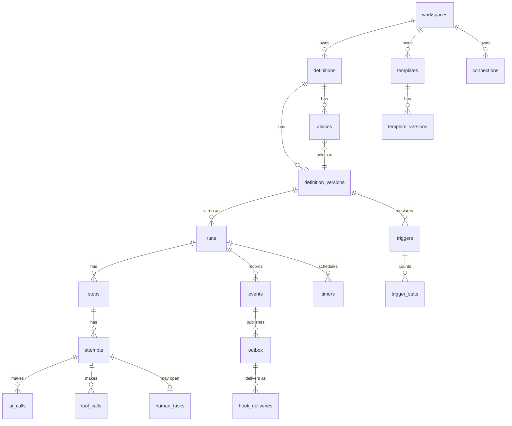

# Weir database design

Design, 16 November 2026. Status: proposal for the first working version. Nothing here is built.

Postgres is the only state Weir has. This document sets out the tables, the states a run and a step move through, the rules the database itself enforces, and the handful of queries the engine depends on. It follows the nouns in [the spec](../spec/weir-spec.md).

## Principles

1. **One transaction per transition.** A state change, the event that records it, and the outbox row that wakes a worker or fires a hook commit together or not at all.
2. **The event log is the truth about the past.** The `runs`, `steps` and `attempts` tables hold current state for fast queries. They can be rebuilt from `events`.
3. **Immutable things are immutable in the database,** by trigger, not by convention: published versions, template versions and events.
4. **A token is the only way to complete an attempt.** Tokens are stored hashed, and completion is a conditional write.
5. **Time is rows.** Nothing waits in memory. Retries, timeouts, polls and escalations are rows with a time on them.
6. **Large payloads live outside the hot tables,** in `blobs`, and are referenced by hash.
7. **Every table carries `workspace_id`.** The first version has one workspace, but adding tenancy later is far harder than carrying the column now.

## The tables at a glance



| Group | Tables | Purpose |
| --- | --- | --- |
| Tenancy and access | `workspaces`, `api_keys`, `role_bindings` | Who may call the API, and who holds which role |
| What can run | `definitions`, `definition_versions`, `aliases`, `templates`, `template_versions`, `handlers`, `connections`, `tiers` | Everything a published workflow refers to |
| What is running | `runs`, `steps`, `attempts`, `human_tasks`, `timers` | Current state |
| What happened | `events`, `ai_calls`, `tool_calls`, `blobs` | The audit record |
| Getting things out | `outbox`, `hook_deliveries` | Wake-ups and outbound hooks |
| Getting things in | `triggers`, `trigger_stats`, `inbound_events` | What starts a run |
| Operations | `workers` | Which workers are alive and what they can do |

## What can run

**`definitions`** — one row per workflow name.

| Column | Notes |
| --- | --- |
| `id`, `workspace_id` | |
| `namespace`, `name` | Unique together within a workspace |

**`definition_versions`** — a published, immutable version.

| Column | Notes |
| --- | --- |
| `definition_id`, `version` | Unique together. `version` only ever increases |
| `source` | The YAML exactly as published |
| `spec` | The parsed, normalised form as JSON. The engine reads this, never the YAML |
| `spec_hash` | SHA-256 of `spec` |
| `contract_version` | The value of `weir:` in the document |
| `pins` | Every reference resolved at publish time: template versions, handler names, connection names, tiers |
| `published_by`, `published_at` | |

**`aliases`** — a stable name such as `live` that points at a version. Changing an alias writes an event, so the history of what `live` meant is kept.

**`templates` and `template_versions`** — prompts for `ai` steps and templates for `decide` steps. A version holds the system and user text, the labels and their meanings for a decide template, the output schema, and the default tier. Versions are immutable.

**`handlers`** — the deterministic handlers that workers have registered, with their input and output schemas and the name of any undo handler. Publishing a definition checks its handler names against this table.

**`blobs`** — files kept by Weir when no bucket is configured: a key, the bytes, their size and digest. With `WEIR_BLOB_URL` set, files go to that bucket (S3, Google Cloud Storage, Azure Blob Storage or a directory) and this table stays empty. Either way the rest of Weir uses one interface and does not know which it is.

**`run_files`** — the files a step produced: the run, the step visit, the path the agent wrote, size, digest, type, and the file's key in the file store. The key is random and holds no part of the path, so nothing an agent writes decides where a file lands. Rows are written in the transaction that completes the step.

**`schedules`** — when each scheduled trigger of a workflow's live version is next due, with when it last fired and why it could not start a run if it could not. The rows are rewritten each time the workflow is published, and the sweep reads them.

**`connections`** — a named third party, per workspace: its address, whether it is a plain HTTP address or an MCP server (with the tools it offered), and how Weir signs in to it. Signing in is a kind (`bearer`, `header` or `basic`) and `secret_ref`, a reference such as `env:GITHUB_TOKEN`. The secret itself is never stored here or anywhere else in the database: it is read from the server's environment or a file when a call is made, and a workspace can name only its own. A connection can also receive: `webhook` says how the third party signs what it sends (GitHub's scheme, or a general HMAC), again with only a reference to the shared secret. The sites a connection may reach are not recorded yet.

**`tiers`** — named model sizes: provider, model, effort and context size.

## What is running

**`runs`**

| Column | Notes |
| --- | --- |
| `id`, `workspace_id`, `definition_version_id` | A run stays on the version it started with |
| `status` | See the state table below |
| `input`, `output` | JSON, or a blob reference when large |
| `requester` | Who or what started it. Used for separation of duties |
| `idempotency_key` | Unique per definition. Starting twice with the same key returns the same run |
| `parent_run_id`, `parent_step_id` | Set when the run is a sub-workflow |
| `budget_usd`, `spent_usd` | The limit and the running total |
| `created_at`, `started_at`, `finished_at` | |

**`steps`** — one row each time a run reaches a step.

| Column | Notes |
| --- | --- |
| `id`, `run_id`, `step_key`, `visit` | Unique together. `visit` counts repeat visits to the same step |
| `kind` | `decide`, `ai`, `deterministic`, `human` or `external` |
| `status` | See the state table below |
| `input`, `output` | Output is written once and never recomputed |
| `label`, `outcome` | The decide label or the human outcome, for `next` rules |
| `attempts_made`, `max_attempts` | |
| `not_before` | When the step may next be claimed. Used for backoff and polling |
| `spent_usd`, `budget_usd` | |
| `error` | The final error, in the standard error shape |

**`attempts`** — one try at a step.

| Column | Notes |
| --- | --- |
| `id`, `step_id`, `number` | Unique together |
| `status` | `running`, `waiting`, `succeeded`, `failed`, `timed_out`, `abandoned` |
| `token_hash` | SHA-256 of the token. Unique. The token itself is never stored |
| `worker_id`, `lease_until`, `heartbeat_at` | For attempts a worker holds |
| `idempotency_key` | Passed to handlers and third parties |
| `actor` | Who completed it: a worker, a person, or a connection |
| `error`, `started_at`, `finished_at` | |

**`human_tasks`** — the inbox. One row per waiting human step: the role or person it is assigned to, who is excluded, when it is due, the escalation level reached, and the decision once made.

**`timers`** — something that must happen to a waiting step at a time: a timeout, an escalation, or a poll. One row each, with `fire_at` and `fired_at`.

## States

**Run**

| Status | Meaning | Moves to |
| --- | --- | --- |
| `pending` | Created, nothing claimed yet | `running`, `cancelled` |
| `running` | At least one step is runnable or held by a worker | `waiting`, `succeeded`, `failed`, `blocked`, `cancelled` |
| `waiting` | Every live step is parked on a person or a third party | `running`, `failed`, `cancelled` |
| `blocked` | A step failed with `on_failure: block`. Completed work is kept | `running` (on resume), `cancelled` |
| `succeeded` | Reached a step marked `end`, or ran out of steps | none |
| `failed` | A step failed with `on_failure: cancel`, and compensation has run | none |
| `cancelled` | Stopped by a person or the API | none |

**Step**

| Status | Meaning | Moves to |
| --- | --- | --- |
| `runnable` | Ready for a worker once `not_before` has passed | `running`, `waiting`, `cancelled` |
| `running` | A worker holds a live attempt | `succeeded`, `runnable` (retry), `failed` |
| `waiting` | Parked under a token: a person or a third party must return it | `succeeded`, `runnable` (retry), `failed` |
| `succeeded` | Output stored | `compensated` |
| `failed` | Retries used up | none |
| `skipped` | A `when` condition was false | none |
| `cancelled` | The run was cancelled or failed before this step finished | none |
| `compensated` | Its undo handler has run | none |

## What happened

**`events`** — append-only. Every transition writes one.

| Column | Notes |
| --- | --- |
| `id` | A sequence, for a global order |
| `run_id`, `seq` | Unique together. `seq` orders events within a run |
| `step_id`, `attempt_id` | Where relevant |
| `type` | For example `run.started`, `step.waiting`, `attempt.failed`, `alias.moved` |
| `actor`, `at`, `data` | Who, when, and the details |

**`ai_calls`** — one row per model call, including the routing decision the gateway makes: provider, model, tier, template version, prompt hash, references to the request and response blobs, tokens in and out, cost, duration and outcome.

**`tool_calls`** — one row per tool call an agent makes: the tool, its class (read or write), the arguments, the result reference, whether it was allowed, denied or approved, and by whom.

**`blobs`** — large payloads and transcripts, keyed by SHA-256. Stored in Postgres in the first version, behind an interface so that object storage can replace it.

## Getting things out and in

**`outbox`** — written in the same transaction as the event it follows. Kinds are `wake` (a step is runnable), `hook` (notify a third party) and `event` (publish to a bus). A dispatcher delivers rows and marks them done. A lost wake-up is recovered by the sweep.

**`hook_deliveries`** — each delivery attempt of a hook: the signature id, the response code, and when to retry.

**`triggers`** — the triggers a published version declares, with their source, match rule and optional decide.

**`trigger_stats`** — daily counts per trigger: matched, dropped by the rule, dropped by the classifier, and started. Events that are dropped are counted here and not stored.

**`inbound_events`** — only the events that started or resumed a run, with a dedupe key.

## Rules the database enforces

| Rule | How |
| --- | --- |
| Published versions never change | A trigger rejects `UPDATE` and `DELETE` on `definition_versions` and `template_versions` |
| Events are never rewritten | A trigger rejects `UPDATE` and `DELETE` on `events` |
| A step has at most one live attempt | A partial unique index on `attempts (step_id)` where status is `running` or `waiting` |
| A token completes at most one attempt, once | `token_hash` is unique, and completion is a conditional update (below) |
| A run is not started twice | A unique index on `runs (definition_id, idempotency_key)` |
| A step's output is written once | A check that `output` only changes from null |
| Spend cannot pass the budget unnoticed | Cost is added to `steps.spent_usd` and `runs.spent_usd` in the same transaction as the `ai_calls` or `tool_calls` row |

## The queries the engine depends on

**Claim a step.** A short transaction: find a runnable step, create its attempt, set the lease.

```sql
SELECT id FROM steps
WHERE status = 'runnable' AND not_before <= now() AND kind = ANY($1)
ORDER BY not_before
FOR UPDATE SKIP LOCKED
LIMIT 1;
```

A partial index on `steps (not_before) WHERE status = 'runnable'` keeps this fast as finished steps pile up.

**Complete an attempt.** The write succeeds only if the token is still the live one. A stale worker, a duplicate callback and a late reply all update zero rows and are rejected.

```sql
UPDATE attempts
SET status = 'succeeded', finished_at = now(), actor = $2
WHERE token_hash = $1 AND status IN ('running', 'waiting')
RETURNING step_id;
```

**Sweep.** One pass finds everything time has caught up with: attempts whose lease has expired, timers that are due, and outbox rows that were never delivered.

## What is left out of the first version

| Left out | Why | When |
| --- | --- | --- |
| Pipes, the catalogue and hosted tool servers | They sit on top of connections and the tool proxy, which come first | After the first tagged version |
| Circuit breaker and rate-limit tables | Useful once real third parties are attached | With governance hardening |
| Content matching for callbacks | A token covers the first version | With Pipes |
| Table partitioning and archiving | Only matters at volume | When a real workload needs it |
| Row-level security per workspace | One workspace at first; the column is already there | With the hosted service |

## Open questions

- [ ] Should `steps` and `attempts` merge for kinds that never retry? Keeping them separate is simpler to reason about and costs one extra row.
- [ ] Is `events.seq` assigned by a per-run counter on `runs`, or by a sequence with gaps? A counter gives a strict order and takes a row lock that the transition already holds.
- [ ] How long are `blobs` kept, and are transcripts ever deleted for privacy?
- [ ] Do fan-out and parallel branches need a `parent_step_id` on `steps` from the start, even if the first version runs steps one at a time?
