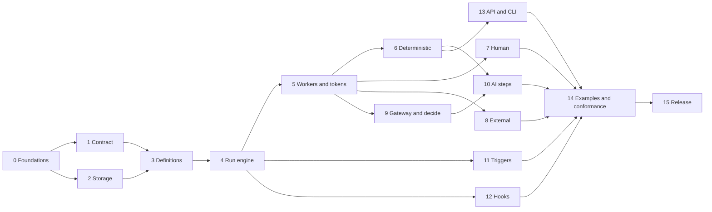

# Weir build plan: epics to the first tagged version

Plan, 16 November 2026. This is the working to-do list. Tick items off as they land.

The goal is a version that runs locally, supports all five step kinds, and can be tagged `v0.1.0` before the repository is made public. Work is planned at the level of epics and features. There are no stories or tasks underneath.

## Where it stands

Updated 16 November 2026. This file is the project's to-do list. Tick an item in the same change that finishes it.

A real workflow has run end to end from the command line with the Claude command line doing the model steps: a support message was classified, a reply drafted, the requester refused when she tried to approve it, and the reply sent after someone else approved. The run cost $0.0006.

| Epic | State | What is left |
| --- | --- | --- |
| 0 Foundations | Done | CI has never run, because the repository is not on GitHub |
| 1 Contract | Mostly done | A JSON Schema for definitions; type-checking expressions; the event and error catalogues |
| 2 Storage | Done | The blob store |
| 3 Definitions | Mostly done | Alias history; `weir versions` and `weir alias` |
| 4 Run engine | Done | |
| 5 Workers and tokens | Mostly done | Waking a worker on a Postgres notification (streams already use them; workers still poll) |
| 6 Deterministic steps | Mostly done | Typed handlers; HTTP and wait built-ins |
| 7 Human steps | Mostly done | Checking that the person deciding holds the role; reopening a decision |
| 8 External steps | Mostly done | Authentication on connections; allowed sites |
| 9 Gateway and decide | Mostly done | A live call to Jev and to Gemini Decisions (no keys yet); the Gemini command line; Codex steps with tools; a fallback provider; shadow mode; workload identity and a direct-call runner |
| 10 AI steps | Mostly done | The `approve` class of tool; marking tool output as data; the full transcript (the prompt and the final reply are kept, the turns in between are not) |
| 11 Triggers | Mostly done | A `decide` filter in a trigger; counters; a schedule trigger |
| 12 Hooks | Mostly done | A signature on each request; hooks on a single step |
| 13 API and command line | Mostly done | Sign-in for people (the console takes a key today); a published API description; logs and metrics; the newer endpoints on the command line |
| 14 Examples and conformance | Started | Two more examples; tests for all three; the conformance suite. A real application (agent-demo) runs on Weir, which the plan did not ask for |
| 15 Release | Not started | |

## What "working" means

`v0.1.0` is done when all of this is true on a laptop, with one command to start it.

- [ ] `docker compose up` starts Postgres and Weir, and `weir` on the command line can publish a workflow, start a run and show its status.
- [ ] The three worked examples from the website run end to end: a bug at 2am, a support inbox, and a vulnerable library.
- [ ] Each example uses a fake model and fake third parties in tests, so the suite needs no keys and costs nothing.
- [x] One example can also be run against a real model provider by setting a key.
- [x] Killing a worker in the middle of a step does not lose or duplicate the step.
- [x] A late or repeated completion for an attempt is rejected.
- [x] A run stops when its budget is spent.
- [x] The person who started a run cannot approve it when the workflow says so.
- [ ] Every run produces an event log that matches the expected log in the conformance suite.
- [ ] Tests gate every merge in CI.

## What is deliberately not in v0.1.0

| Not included | Reason |
| --- | --- |
| Scale to zero on Cloud Run | The first version proves the engine locally. The wake-up path is its own milestone |
| Pipes, the catalogue, remote and hosted MCP servers | They build on connections and the tool proxy |
| Circuit breakers and rate limits | Needed once real third parties are attached |
| An approval inbox screen | Approvals work through the API and the command line first |
| Parallel branches and fan-out | Steps run one at a time in the first version |
| More than one workspace | The column exists; the access model comes later |

## Decisions

| Decision | Outcome |
| --- | --- |
| Where the code lives | A clean `weir` repository. This repository stays as research and is not published |
| How an AI step runs | Through a command line, on a long-lived OAuth token, as the earlier projects do. Claude first, then Codex, Gemini and others as provider adapters, as an earlier project had. The runner and the provider are configuration settings, so an API key can be used when one is available. See [Agent runners and providers](03-agent-runners.md) |
| The expression language | CEL through `cel-go`, so expressions can be type-checked against step schemas at publish time. Proposed, not yet confirmed |
| Licence | Apache 2.0. Proposed, not yet confirmed |
| Go module path | `github.com/bobbydeveaux/weir` |

## Order of work

Epics 6, 7, 8 and 9 do not depend on each other and can be built in any order once epic 5 is done. The quickest route to something that runs is 0, 1, 2, 3, 4, 5, 6, then 13.

## Epics

### 0. Foundations

A repository that builds, tests and runs with one command.

- [x] Go module, directory layout matching the spec (`spec/`, `engine/`, `adapters/`, `handlers/`, `examples/`, `conformance/`)
- [x] `docker compose` with Postgres, and a `make` target for each common job
- [x] Migrations tool wired in, with an empty first migration
- [ ] CI that runs format, vet, lint and tests, and blocks merges on failure (the workflow is written; it has not run, and merge blocking needs the repository to be on GitHub)
- [x] Licence, contributing guide, security policy

### 1. The contract

The definition format, checked before anything is stored.

- [ ] A JSON Schema for workflow definitions, covering all five step kinds and the shared envelope
- [x] A YAML parser that produces the normalised form the engine reads
- [x] Publish-time checks: every reference resolves, every AI step has a prompt, schema and budget, every decide has labels and a default
- [ ] The expression language, type-checked against step output schemas (CEL is in and checked for syntax at publish; not yet type-checked against schemas)
- [ ] The event catalogue and the error catalogue, as data

### 2. Storage

The schema in [the database design](01-database-design.md).

- [x] Migrations for every table in the first version
- [x] Triggers for immutable versions and the append-only event log
- [x] A store package with one function per transition, each a single transaction
- [ ] A blob store interface with a Postgres implementation
- [x] Tests that run against a real Postgres, not a fake

### 3. Definitions, versions and aliases

- [x] Publish a definition as a new immutable version
- [ ] Pin every reference at publish time and store the pins
- [ ] Aliases that point at a version, with history (a `live` alias moves on publish; no history or other aliases yet)
- [x] Templates and their immutable versions, for prompts and decide templates
- [ ] `weir publish`, `weir versions`, `weir alias` (`publish` only)

### 4. The run engine

The state machine, with no workers yet.

- [x] Start a run, idempotently by key, on the version an alias points at
- [x] Advance: decide the next step from `next` and `when`, create it, and write the event and outbox row in one transaction
- [x] Finish a run on `end` or when steps run out
- [x] Failure policy: `block`, `cancel` and `continue`
- [x] Compensation in reverse order on `cancel`
- [x] Resume a blocked run from the failed step, keeping completed results
- [x] Budget accounting at run and step level

### 5. Workers and tokens

How work is claimed, held and returned.

- [x] Claim a runnable step in a short transaction, with a lease
- [x] Issue a token per attempt, stored hashed, rotated on retry
- [x] Complete or fail an attempt by token, as a conditional write
- [x] Heartbeats that extend a lease
- [x] Retries with backoff, and per-attempt and overall timeouts
- [x] A sweep for expired leases, due timers and undelivered outbox rows (hooks in the outbox are delivered by the worker)
- [ ] A local wake-up path: Postgres notifications, with polling as the fallback (notifications drive the streams; workers and hook delivery still poll, every half second)

### 6. Deterministic steps

- [ ] A handler registry, with declared input and output types (the registry is done; handlers do not declare types yet)
- [ ] Input and output checked against those types
- [x] An idempotency key passed to every handler call
- [ ] A small Go library for writing handlers
- [ ] Built-in handlers: HTTP request, wait, and a no-op for tests (no-op and echo only)

### 7. Human steps

- [x] A task opened when a human step starts, assigned to a role or a person
- [x] Separation of duties: `not: run.requester` enforced by the engine
- [x] Outcomes that `next` rules can branch on
- [x] Timeouts and an escalation chain
- [x] Approve and reject through the API and `weir approve`

### 8. External steps

- [ ] Connections: address, authentication method, allowed sites, a reference to the secret (address and kind, HTTP or MCP; no authentication or allowed sites yet)
- [x] Make the call, then park the step under its token
- [x] A callback endpoint that accepts the token and validates the payload against the output schema
- [x] Poll mode: repeat until a declared condition holds
- [x] A fake third party for tests

### 9. The AI gateway and decide steps

- [x] A runner interface, chosen by a configuration setting: `cli`, `api` or `fake`
- [ ] A provider adapter interface: how to pass the prompt, name the model, ask for structured output, restrict tools, and read cost and usage
- [x] The `cli` runner with the Claude adapter: a long-lived OAuth token, permission checks on, a clean environment and a time limit (checked with real calls)
- [ ] Capabilities declared per provider, with a definition refused at publish if a step needs a guarantee its provider cannot give
- [x] Codex adapter: locked-down `codex exec`, tokens read from the event stream, cost estimated from prices. Steps with tools are refused. Proven with a live call on 2026-11-16 (Codex 0.169.0, `gpt-6.1-sol`): a two-label decision took 12,518 tokens in and 21 out, because Codex adds its own instructions to every call, so small decisions are better left on Claude's small model
- [x] Routing by tier: a step with `tier: codex` goes to Codex, everything else to Claude
- [x] Decision models for `decide`: Jev and Gemini Decisions over HTTP, chosen per step with `provider:`; Jev is the default when it has a key. Tested against stand-in servers, not yet against the real services
- [ ] Gemini adapter (the command line, for `ai` steps)
- [x] Multi-tenant API: `X-Weir-Workspace` on every request, workspaces listed and created over the API, a test that one workspace cannot see or change another's
- [x] Read API: workflows, versions, runs, the audit record, templates, connections, usage, the registry
- [x] Documents for agents (`files` on an `ai` step), MCP servers as a source of tools, data on a decision, prompt and reply kept per model call
- [x] First application on Weir: agent-demo, proven end to end locally. See [agent-demo on Weir](04-agent-demo-on-weir.md)
- [x] MCP connections per workspace: made over the API, tools visible to and callable from that workspace only; the install-wide setting is gone
- [x] The console (SvelteKit) over the read API: overview, workflows with a diagram, runs, tasks, templates, connections. Screenshots in `docs/console/`
- [x] Events and triggers: `POST /v1/events`, and `triggers:` enforced (event type, an optional `when`, an optional input mapping), so an application reports what happened and Weir finds the workflows. A repeated event starts nothing new. Not yet: a `decide` step in the trigger, and events arriving from a queue
- [x] Hooks: a `hooks:` block (`on`, `connection`, `path`); queued with the event they report, delivered by the worker, retried up to eight times with a growing wait, and listed in a run's record. Not yet: hooks on a single step, signing the request, and showing them in the console
- [x] Streams (Server-Sent Events): `GET /v1/runs/{id}/stream` sends a run's events as they happen and resumes from `Last-Event-ID`; `GET /v1/stream` says which runs in a workspace moved. Driven by Postgres `LISTEN`/`NOTIFY`, with a slow look as a safeguard. The console follows both
- [x] Cancelling a run, and blocked runs counted apart from active ones
- [ ] Reopening a decision, so that the right person can redo an approval made by the wrong one
- [ ] Authentication on connections (an ID token from Weir's own identity, an API key, or a bearer secret), so that Weir can reach MCP servers and applications that are not on the local network
- [ ] An owner on each workflow (an application, git, or the console), then publishing and editing in the console for those it owns
- [x] Claude on Bedrock or Vertex AI on the machine's cloud identity, and through an AI gateway, by letting named variables through to the command line; tier models and a model prefix as settings. Tested for what reaches the agent; not yet run against a real account
- [ ] A runner that hands an `ai` step to an agent hosted elsewhere (AgentCore, Fargate, Cloud Run), as an earlier project of the author's has
- [ ] Workload identity as a way to sign in (Google Workload Identity Federation, AWS IAM roles, Azure managed identity), beside the OAuth token and the API key. See [Agent runners](03-agent-runners.md)
- [ ] An `api` runner for `ai` steps with its own tool loop, with Vertex AI, Bedrock and Azure AI Foundry behind it
- [ ] Provider settings per workspace
- [x] The `fake` runner, for tests and the examples
- [x] Every model call recorded: template version, prompt hash, tokens, cost (marked measured or notional), duration
- [x] Budget check before each call, and a budget error that stops the step
- [ ] Tiers, and routing an AI step to a tier by a decide
- [ ] The decide step: closed labels, a confidence threshold, a safe default, a fallback provider (all done except the fallback provider; a step can also name its provider and describe its labels)
- [ ] Shadow mode for routing

### 10. AI steps

- [x] Run an agent through the configured runner, within a budget and a time limit
- [x] Output validated against the step's JSON Schema
- [ ] The full transcript stored against the attempt (the prompt as sent and the final reply are stored, with every tool call; the model's turns in between are not)
- [x] The tool proxy, exposed to the command line as its only MCP server: an allow-list per step, with read and write classes (the `approve` class is the next item)
- [x] Tools from the server's registry and from a workspace's MCP connections exposed to agents
- [ ] A write under `approve` parks until a person approves that exact call
- [ ] Tool output marked as data, and a tainted run blocked from writing to a different third party

### 11. Triggers

- [x] An inbound event endpoint (`POST /v1/events`), which starts nothing new for a repeated event
- [x] The `match` rule, run on every event at no model cost (the event type and an optional `when`)
- [ ] The optional `decide` filter, run only on events that pass the rule
- [ ] Daily counters for matched, dropped and started
- [ ] A schedule trigger

### 12. Hooks

- [ ] Hooks declared on a step or a definition (on a definition: done)
- [x] Delivery through the outbox, at least once, with backoff
- [ ] A signature and a unique delivery id on every request (the id: done; no signature)
- [x] A delivery log (in a run's record), and a failed hook that never fails the run

### 13. API, command line and visibility

- [ ] An HTTP API with a published description, covering definitions, runs, approvals and events (the API is built; it has no published description)
- [x] `weir run`, `weir status`, `weir logs`, `weir approve`, `weir resume`
- [x] A run timeline: every step, attempt, cost and actor in order
- [ ] Structured logs and basic metrics
- [x] API keys and roles: `WEIR_ADMIN_KEY` turns authentication on; a key belongs to one workspace and is a reader, a writer or an admin; a key may be allowed to act for an application's users; only a hash is stored. Proven with agent-demo running against a locked server
- [ ] Sign-in for people (single sign-on), so that the console does not need a pasted key and an approver's identity is proven, not asserted by an application

### 14. Examples and conformance

- [ ] The three website examples as real workflows in `examples/`, each with a test (the support inbox is there and has been run for real; it has no automated test, and the other two are not written)
- [ ] A conformance suite: a definition, its inputs, and the event log it must produce
- [x] Crash tests: kill a worker mid-step; send a completion twice; let a lease expire
- [ ] A quickstart that gets a new reader from clone to a finished run

### 15. Release

- [ ] Every item under "What working means" is ticked
- [ ] README, with the status stated plainly
- [ ] Internal documents removed or redacted
- [ ] Tag `v0.1.0`
- [ ] Publish the repository, and point the website's two placeholder buttons at it

## The first real tenant: a feature factory on Weir

Once the base engine works, the first real workload is a feature factory built as a Weir workflow. It replaces an earlier project's ten custom resources and 12-step waterfall with one definition, at feature level.

| Step | Kind | Notes |
| --- | --- | --- |
| Size the feature | decide | How much planning it needs |
| Plan | AI | In proportion to its size |
| Approve the plan | human | |
| Implement on a branch | AI | One provider |
| Run the tests | deterministic | |
| Review | AI | A different provider, so the work is not reviewed by the model that wrote it |
| Merge | deterministic | The agent never holds the credentials |
| Confirm CI is green | external | |

**What it needs first.** Epics 0 to 10 and 13, at least two provider adapters, and a few source control handlers: open a pull request, merge, and run tests.

**What it is for.**

- A test of every step kind on a real job.
- Like-for-like comparisons between providers. Every attempt already records provider, model, cost, duration and outcome, so running one feature through several models needs no extra instrumentation.
- Building the rest of Weir. Triggers, hooks, the examples and the conformance suite are well specified and self-contained, which suits it.

**Guard rails for a system that builds itself.**

- A person approves every merge into Weir, and CI gates it.
- The engine can always be built and fixed by hand, so a bug in Weir cannot stop the work on Weir.

The merge queue and the patrol from that earlier project return once more than one feature runs at a time.

## After v0.1.0

| Milestone | Contents |
| --- | --- |
| Scale to zero | The wake-up and sweep path on Cloud Run, with a measured idle cost |
| Governance hardening | Circuit breakers, rate limits, the approval inbox screen, the `api` runner |
| Pipes | The Pipe manifest, the first source control Pipes, remote MCP servers |
| Control flow | Parallel branches, fan-out over a list, sub-workflows |
| Catalogue | Public Pipes with publisher review, and hosted tool servers |
| 1.0 | A frozen contract, proven by a real platform running on it |
