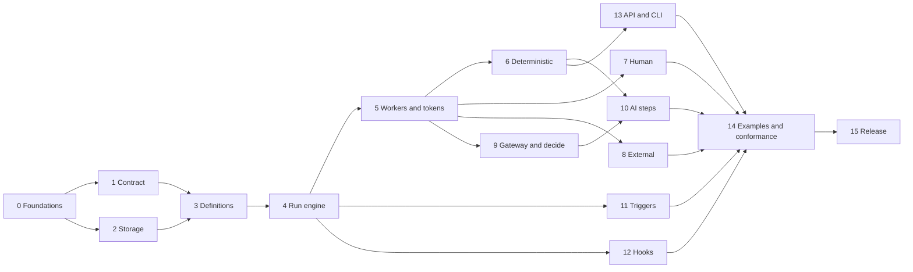

# Weir build plan: epics to the first tagged version

Plan, 16 November 2026. This is the working to-do list. Tick items off as they land.

The goal is a version that runs locally, supports all five step kinds, and can be tagged `v0.1.0` before the repository is made public. Work is planned at the level of epics and features. There are no stories or tasks underneath.

## Where it stands

Updated 18 November 2026. This file is the project's to-do list. Tick an item in the same change that finishes it.

A real workflow has run end to end from the command line with the Claude command line doing the model steps: a support message was classified, a reply drafted, the requester refused when she tried to approve it, and the reply sent after someone else approved. The run cost $0.0006.

Since then two real applications have run on it. The second is a live application's fix-the-vulnerability workflow, run locally against a real repository: an agent in a container of its own assessed a vulnerable dependency, a person overrode its route at a gate, a second agent wrote tests and a third made the fix, and two real pull requests were opened. Nothing is deployed yet.

| Epic | State | What is left |
| --- | --- | --- |
| 0 Foundations | Done |  |
| 1 Contract | Mostly done | A JSON Schema for definitions; type-checking expressions; the event and error catalogues |
| 2 Storage | Done | |
| 3 Definitions | Mostly done | Alias history; `weir versions` and `weir alias` |
| 4 Run engine | Done | Undoing completed steps on cancel |
| 5 Workers and tokens | Mostly done | Waking a worker on a Postgres notification (streams already use them; workers still poll) |
| 6 Deterministic steps | Mostly done | Typed handlers; HTTP and wait built-ins |
| 7 Human steps | Mostly done | Checking that the person deciding holds the role; reopening a decision |
| 8 External steps | Mostly done | Signing in with the machine's own cloud identity; allowed addresses |
| 9 Gateway and decide | Mostly done | A live call to Jev and to Gemini Decisions (no keys yet); the Gemini command line; Codex steps with tools; a fallback provider; shadow mode; workload identity and a direct-call runner |
| 10 AI steps | Mostly done | Model calls sent through Weir, so a container holds no model credential; an agent image per application; the `approve` class of tool; marking tool output as data; the full transcript |
| 11 Triggers | Mostly done | A step that waits for an event; a `decide` filter in a trigger; counters |
| 12 Hooks | Mostly done | Hooks on a single step |
| 13 API and command line | Mostly done | Sign-in for people (the console takes a key today); a published API description; logs and metrics; the newer endpoints on the command line |
| 14 Examples and conformance | Started | Two more examples; tests for all three; the conformance suite. Two real applications have run on Weir, which the plan did not ask for; the second is not switched over |
| 15 Release | Started | The repository is public. No tagged version yet |
| 16 Pipes | Started | GitHub is the first: signed webhooks in, tools, a GitHub App to sign in with, a checkout and a commit that opens a pull request, proven against the real GitHub. Left: the package format, Slack, and connecting from the console |
| 17 Running in the cloud | Started | Images, a Helm chart, and agents as Kubernetes Jobs or Cloud Run jobs are built. Nothing is deployed, and the Cloud Run launcher has not met the real service. Left: scale to zero, long steps off the request, guides for each cloud, AWS |
| 18 Learning and authoring | Not started |  |

## What "working" means

`v0.1.0` is done when all of this is true on a laptop, with one command to start it.

- [ ] `docker compose up` starts Postgres and Weir, and `weir` on the command line can publish a workflow, start a run and show its status.
- [ ] The three worked examples from the website run end to end: a bug at 2am, a support inbox, and a vulnerable library.
- [ ] Each example uses a fake model and fake third parties in tests, so the suite needs no keys and costs nothing.
- [x] One example can also be run against a real model provider by setting a key.
- [x] Killing a worker in the middle of a step does not lose or duplicate the step.
- [x] A late or repeated completion for an attempt is rejected.
- [x] A run stops when its budget is spent.
- [x] The person who started a run cannot approve it when the workflow says so.
- [ ] Every run produces an event log that matches the expected log in the conformance suite.
- [x] Tests gate every merge in CI.

## What is deliberately not in v0.1.0

| Not included | Reason |
| --- | --- |
| Scale to zero on Cloud Run | The first version proves the engine locally. The wake-up path is its own milestone |
| Pipes, the catalogue, remote and hosted MCP servers | They build on connections and the tool proxy |
| Circuit breakers and rate limits | Needed once real third parties are attached |
| An approval inbox screen | Approvals work through the API and the command line first |
| Parallel branches and fan-out | Steps run one at a time in the first version |
| More than one workspace | The column exists; the access model comes later |

## Decisions

| Decision | Outcome |
| --- | --- |
| Where the code lives | A clean `weir` repository. This repository stays as research and is not published |
| How an AI step runs | Through a command line, on a long-lived OAuth token, as the earlier projects do. Claude first, then Codex, Gemini and others as provider adapters, as an earlier project had. The runner and the provider are configuration settings, so an API key can be used when one is available. See [Agent runners and providers](03-agent-runners.md) |
| The expression language | CEL through `cel-go`, so expressions can be type-checked against step schemas at publish time. Proposed, not yet confirmed |
| Licence | Apache 2.0. Proposed, not yet confirmed |
| Go module path | `github.com/bobbydeveaux/weir` |
| Every model call goes through Weir | A step that calls a model is an `ai` or `decide` step, so that the prompt, the model, the tools, the budget and the record are Weir's. Where the agent runs is a setting |
| Where an agent runs | In a container of its own, with every tool and nothing in reach worth stealing. That is the baseline for an agent that does real work, not an extra. The container talks only to Weir's API with the one-time token for its step; what it may reach on the network is the platform's to decide. Running beside the worker, inside a sandbox, stays for simple agents and for a laptop with no Docker |
| Agents that work on a repository | Weir does it, rather than leaving each application to write its own harness, because the harness is the security-critical part. The engine stays general: it prepares a working directory through a registered handler, gives the agent a sandboxed shell, and keeps what changed. Everything that knows about git is in the GitHub Pipe, as deterministic code: check out before, commit from a fresh clone after. An agent never holds a token that can write |

## Order of work

Epics 6, 7, 8 and 9 do not depend on each other and can be built in any order once epic 5 is done. The quickest route to something that runs is 0, 1, 2, 3, 4, 5, 6, then 13.

## Epics

### 0. Foundations

A repository that builds, tests and runs with one command.

- [x] Go module, directory layout matching the spec (`spec/`, `engine/`, `adapters/`, `handlers/`, `examples/`, `conformance/`)
- [x] `docker compose` with Postgres, and a `make` target for each common job
- [x] Migrations tool wired in, with an empty first migration
- [x] CI that runs format, vet and tests for the engine and a type check and build for the console, and blocks merges on failure (`main` is protected: pull requests only, both jobs must pass)
- [x] Licence, contributing guide, security policy
- [x] Branches, commits and pull requests named after the issue they close (`feature/issue-0-…`, `#0: …`, and a closing line in the description), checked by CI on every pull request (#65)
- [x] The naming examples use issue number 0, so that quoting the rule cannot close a real issue (#67)

### 1. The contract

The definition format, checked before anything is stored.

- [ ] A JSON Schema for workflow definitions, covering all five step kinds and the shared envelope (#1)
- [x] A YAML parser that produces the normalised form the engine reads
- [x] Publish-time checks: every reference resolves, every AI step has a prompt, schema and budget, every decide has labels and a default
- [ ] The expression language, type-checked against step output schemas (CEL is in and checked for syntax at publish; not yet type-checked against schemas) (#2)
- [ ] The event catalogue and the error catalogue, as data (#3)

### 2. Storage

The schema in [the database design](01-database-design.md).

- [x] Migrations for every table in the first version
- [x] Triggers for immutable versions and the append-only event log
- [x] A store package with one function per transition, each a single transaction
- [x] A file store behind one interface: Postgres by default, or a bucket named by `WEIR_BLOB_URL` (S3, Google Cloud Storage, Azure Blob Storage or a directory), with credentials from the platform's own identity. The same tests pass for Postgres, a directory, and S3 against an S3-compatible server; Google Cloud Storage and Azure have not been run (#4)
- [x] Tests that run against a real Postgres, not a fake

### 3. Definitions, versions and aliases

- [x] Publish a definition as a new immutable version
- [ ] Pin every reference at publish time and store the pins (#5)
- [ ] Aliases that point at a version, with history (a `live` alias moves on publish; no history or other aliases yet) (#6)
- [x] Templates and their immutable versions, for prompts and decide templates
- [ ] `weir publish`, `weir versions`, `weir alias` (`publish` only) (#7)
- [ ] An owner on each workflow (an application, git, or the console), then publishing and editing in the console for those it owns (#8)

### 4. The run engine

The state machine, with no workers yet.

- [x] Start a run, idempotently by key, on the version an alias points at
- [x] Advance: decide the next step from `next` and `when`, create it, and write the event and outbox row in one transaction
- [x] Finish a run on `end` or when steps run out
- [x] Failure policy: `block`, `cancel` and `continue`
- [x] Compensation in reverse order on `cancel`
- [x] Resume a blocked run from the failed step, keeping completed results
- [x] Budget accounting at run and step level
- [x] Cancelling a run, and blocked runs counted apart from active ones
- [ ] Undo completed steps when a run is cancelled (today a cancelled run leaves them as they are) (#9)

### 5. Workers and tokens

How work is claimed, held and returned.

- [x] Claim a runnable step in a short transaction, with a lease
- [x] Issue a token per attempt, stored hashed, rotated on retry
- [x] Complete or fail an attempt by token, as a conditional write
- [x] Heartbeats that extend a lease
- [x] Retries with backoff, and per-attempt and overall timeouts
- [x] A sweep for expired leases, due timers and undelivered outbox rows (hooks in the outbox are delivered by the worker)
- [ ] A local wake-up path: Postgres notifications, with polling as the fallback (notifications drive the streams; workers and hook delivery still poll, every half second) (#10)

### 6. Deterministic steps

- [ ] A handler registry, with declared input and output types (the registry is done; handlers do not declare types yet) (#11)
- [ ] Input and output checked against those types (#12)
- [x] An idempotency key passed to every handler call
- [ ] A small Go library for writing handlers (#13)
- [ ] Built-in handlers: HTTP request, wait, and a no-op for tests (no-op and echo only) (#14)

### 7. Human steps

- [x] A task opened when a human step starts, assigned to a role or a person
- [x] Separation of duties: `not: run.requester` enforced by the engine
- [x] Outcomes that `next` rules can branch on
- [x] Timeouts and an escalation chain
- [x] Approve and reject through the API and `weir approve`
- [x] A sample of runs for a person to review: `sample(seed, rate)` in a `next` rule sends about that fraction to a human step and lets the rest go on, the same runs every time. A rate outside 0 to 1 is an error when the rule runs, not when the workflow is published (#122)
- [ ] Reopening a decision, so that the right person can redo an approval made by the wrong one (#15)
- [ ] Check that the person deciding holds the role the step names (today the role is recorded and not checked) (#16)

### 8. External steps
- [x] Connections: a named address, HTTP or MCP, per workspace

- [x] Make the call, then park the step under its token
- [x] A callback endpoint that accepts the token and validates the payload against the output schema
- [x] Poll mode: repeat until a declared condition holds
- [x] A fake third party for tests
- [x] Credentials on a connection, held by reference and never stored: `env:NAME` and `file:name`, sent as a bearer token, a header or basic auth, on every call made through the connection (external steps, files, tools, hooks, MCP). A workspace can name only its own secrets. Tested against stand-in servers; not yet used against a real third party (#17)
- [x] An ID token from the machine's own identity as a connection credential (`id-token`), for one cloud service calling another with no secret at all. Google Cloud only, and off unless `WEIR_ID_TOKENS=google`; not AWS or Azure, and not limited by workspace (#18)
- [ ] Allowed addresses for connections, so that a workspace cannot point Weir at anything it can reach (#19)

### 9. The AI gateway and decide steps

- [x] A runner interface, chosen by a configuration setting: `cli`, `api` or `fake`
- [x] A provider adapter interface: how to pass the prompt, name the model, ask for structured output, restrict tools, and read cost and usage (the `Runner` interface, with Claude, Codex and the decision models behind it)
- [x] The `cli` runner with the Claude adapter: a long-lived OAuth token, permission checks on, a clean environment and a time limit (checked with real calls)
- [ ] Capabilities declared per provider, with a definition refused at publish if a step needs a guarantee its provider cannot give (#20)
- [x] Codex adapter: locked-down `codex exec`, tokens read from the event stream, cost estimated from prices. Steps with tools are refused. Proven with a live call on 2026-11-16 (Codex 0.169.0, `gpt-6.1-sol`): a two-label decision took 12,518 tokens in and 21 out, because Codex adds its own instructions to every call, so small decisions are better left on Claude's small model
- [x] Routing by tier: a step with `tier: codex` goes to Codex, everything else to Claude
- [x] Decision models for `decide`: Jev and Gemini Decisions over HTTP, chosen per step with `provider:`; Jev is the default when it has a key. Tested against stand-in servers, not yet against the real services
- [ ] A live call to Jev and to Gemini Decisions (both are tested against stand-in servers; neither has been run with a real key) (#21)
- [ ] Gemini adapter (the command line, for `ai` steps) (#22)
- [x] Claude on Bedrock or Vertex AI on the machine's cloud identity, and through an AI gateway, by letting named variables through to the command line; tier models and a model prefix as settings. Tested for what reaches the agent; not yet run against a real account
- [ ] Workload identity as a way to sign in (Google Workload Identity Federation, AWS IAM roles, Azure managed identity), beside the OAuth token and the API key. See [Agent runners](03-agent-runners.md) (#24)
- [ ] An `api` runner for `ai` steps with its own tool loop, with Vertex AI, Bedrock and Azure AI Foundry behind it (#25)
- [ ] Provider settings per workspace (#26)
- [x] The `fake` runner, for tests and the examples
- [x] Every model call recorded: template version, prompt hash, tokens, cost (marked measured or notional), duration
- [x] Budget check before each call, and a budget error that stops the step
- [ ] Routing an AI step to a tier by a `decide` (tiers exist, and a step names its tier by hand) (#27)
- [ ] A fallback provider for `decide`, used when the first one fails (today a failure becomes the default label) (#28)
- [ ] Shadow mode for routing (#29)
- [ ] Codex steps that can use tools, through the tool proxy (#30)

### 10. AI steps

- [x] Run an agent through the configured runner, within a budget and a time limit
- [x] Output validated against the step's JSON Schema
- [ ] The full transcript stored against the attempt (the prompt as sent and the final reply are stored, with every tool call; the model's turns in between are not) (#31)
- [x] The tool proxy, exposed to the command line as its only MCP server: an allow-list per step, with read and write classes (the `approve` class is the next item)
- [x] Tools from the server's registry and from a workspace's MCP connections exposed to agents
- [x] An `ai` step with `writes:` can produce files, kept in the file store. A later `ai` step is given them with `files: [{step: …}]`, expressions see `steps.<id>.files`, and the API lists and downloads them. Proven with a real agent on the Claude command line, which was also refused a write outside its directory. Not built: the Codex adapter cannot write files, and nothing removes old files (#77)
- [x] An agent can run in a container of its own (`WEIR_AGENT_RUNNER=docker`): the worker prepares its directory, the container fetches its job and directory from the API with the step's one-time token, runs with every tool, and sends back its output, cost and changed files, all of which Weir checks again. It holds no Weir secret and no third party's credential. Proven with a real agent in a real container on a Mac: it edited a file, deleted one with the shell and wrote a third, as the container's own user, seeing none of Weir's variables. Docker on a Linux host has not been run. The cost is the container's word until #95 (#23)
- [x] What a real remediation workflow needed: `workspace.discard` for a pass that keeps nothing, `effort` on a prompt template, and skills loaded from the agent image's home directory (proven in a real container: with the setting the agent used a skill, without it there was none) (#102)
- [ ] Send an isolated agent's model calls through Weir, so that its container holds no model credential and Weir counts the cost itself (#95)
- [x] An `ai` step with `shell:` gives its agent a shell inside the command line's sandbox: it writes only in the step's working directory, reaches only the hosts the step lists, and cannot read the secrets directory or credential directories. Off unless `WEIR_AGENT_SHELL=on`; a worker with no sandbox refuses the step. Proven with a real agent on macOS; Linux has not been run. For one team running its own Weir: on a shared Weir the agent must run somewhere isolated (#23) (#80)
- [x] An `ai` step with `workspace:` has its working directory filled by registered code before its agent runs. Weir records the directory first and compares afterwards, so what the agent added, changed or deleted is kept in the file store without asking the agent or running anything in the directory. Paths to leave out are fixed before the agent starts, and `.git` is never read back. Proven with a real agent, with a shell, on macOS. Not built: no handler ships yet (#84), and whether a file is executable is not recorded (#81)
- [x] Paths an agent may not change, checked by Weir on what the agent changed after it exits: `writes.only` for a step that may write tests and nothing else, `writes.never`, and paths protected unless a step says otherwise (`.git/`, `.github/workflows/`, `.claude/`, `CLAUDE.md`, `AGENTS.md`). One forbidden change fails the step and keeps nothing. The rules live under `writes`, not under `sandbox.deny_paths`, which still parses and is still reported as not acted on (#82)
- [ ] A write under `approve` parks until a person approves that exact call (#32)
- [ ] Tool output marked as data, and a tainted run blocked from writing to a different third party (#33)
- [x] Documents for agents (`files` on an `ai` step), MCP servers as a source of tools, data on a decision, prompt and reply kept per model call
- [x] MCP connections per workspace: made over the API, tools visible to and callable from that workspace only; the install-wide setting is gone

### 11. Triggers

- [x] An inbound event endpoint (`POST /v1/events`), which starts nothing new for a repeated event
- [x] The `match` rule, run on every event at no model cost (the event type and an optional `when`)
- [ ] The optional `decide` filter, run only on events that pass the rule (#34)
- [ ] Daily counters for matched, dropped and started (#35)
- [x] A schedule trigger: a five-field cron expression in UTC on a trigger. A due schedule starts exactly one run, and one that was missed fires once. Not yet: time zones other than UTC (#36)
- [x] Events and triggers: `POST /v1/events`, and `triggers:` enforced (event type, an optional `when`, an optional input mapping), so an application reports what happened and Weir finds the workflows. A repeated event starts nothing new. Not yet: a `decide` step in the trigger, and events arriving from a queue

### 12. Hooks

- [ ] Hooks declared on a step or a definition (on a definition: done) (#37)
- [x] Delivery through the outbox, at least once, with backoff
- [x] A signature and a unique delivery id on every request: a hook may name a shared secret, and is then sent with `Weir-Timestamp` and `Weir-Signature`, the HMAC-SHA256 of the timestamp and the body. A hook with no secret is sent unsigned, as before (#38)
- [x] A delivery log (in a run's record), and a failed hook that never fails the run
- [x] Hooks: a `hooks:` block (`on`, `connection`, `path`); queued with the event they report, delivered by the worker, retried up to eight times with a growing wait, and listed in a run's record. Not yet: hooks on a single step, signing the request, and showing them in the console

### 13. API, command line and visibility

- [ ] An HTTP API with a published description, covering definitions, runs, approvals and events (the API is built; it has no published description) (#39)
- [x] `weir run`, `weir status`, `weir logs`, `weir approve`, `weir resume`
- [x] A run timeline: every step, attempt, cost and actor in order
- [ ] Structured logs and basic metrics (#40)
- [x] API keys and roles: `WEIR_ADMIN_KEY` turns authentication on; a key belongs to one workspace and is a reader, a writer or an admin; a key may be allowed to act for an application's users; only a hash is stored. Proven with agent-demo running against a locked server
- [x] Behind a sign-in proxy: `WEIR_PROXY_USER_HEADER` names the header the proxy puts the person's address in; that person needs no key and is the actor on everything they do. `WEIR_API_PREFIX` for a proxy that needs a path of its own. Only safe where nothing but the proxy reaches the server: the header's signature is not checked (#117)
- [x] The console served by the server (`WEIR_CONSOLE_DIR`) and shipped in the server image (#117)
- [x] A server that answers the API and leaves the work to another on the same database (`WEIR_WORKER=off`) (#119)
- [ ] Sign-in for people (single sign-on) of Weir's own, with roles for people, so that an approver's identity is proven without a proxy in front (#41)
- [x] Multi-tenant API: `X-Weir-Workspace` on every request, workspaces listed and created over the API, a test that one workspace cannot see or change another's
- [x] Read API: workflows, versions, runs, the audit record, templates, connections, usage, the registry
- [x] The console (SvelteKit) over the read API: overview, workflows with a diagram, runs, tasks, templates, connections. Screenshots in `docs/console/`
- [x] Streams (Server-Sent Events): `GET /v1/runs/{id}/stream` sends a run's events as they happen and resumes from `Last-Event-ID`; `GET /v1/stream` says which runs in a workspace moved. Driven by Postgres `LISTEN`/`NOTIFY`, with a slow look as a safeguard. The console follows both
- [ ] The newer endpoints on the command line: events, cancel, workspaces (#42)
- [ ] Hooks shown in the console, on a run's page (#43)
- [ ] A live board of what is running now, across a workspace (#44)

### 14. Examples and conformance

- [ ] The three website examples as real workflows in `examples/`, each with a test (the support inbox is there and has been run for real; it has no automated test, and the other two are not written) (#45)
- [ ] A conformance suite: a definition, its inputs, and the event log it must produce (#46)
- [x] Crash tests: kill a worker mid-step; send a completion twice; let a lease expire
- [ ] A quickstart that gets a new reader from clone to a finished run (#47)
- [x] First application on Weir: agent-demo, proven end to end locally. See [agent-demo on Weir](04-agent-demo-on-weir.md)
- [ ] A second, live application on Weir: a governed fix-the-vulnerability workflow, with every model call an `ai` step and every gate a `human` step. Needs the shell, the prepared working directory, forbidden paths, and the GitHub Pipe's checkout and commit (#86)

### 15. Release

- [ ] Every item under "What working means" is ticked (#48)
- [x] README, with the status stated plainly (rewritten from this list on 17 November 2026, and it points here for the detail) (#74)
- [x] Internal documents removed or redacted
- [ ] Tag `v0.1.0` (#49)
- [x] Publish the repository, and point the website at it (public since 17 November 2026)

### 16. Pipes

A Pipe is one package per third party: its connection, the events it sends in, the calls that can be made out, and the tools it gives agents. Most of the parts exist separately; this epic packages them.

- [ ] The package format for a Pipe, and installing one into a workspace (#50)
- [x] Inbound webhooks from a third party, with the sender's signature checked, turned into events: `POST /v1/webhooks/{workspace}/{connection}`, GitHub's scheme and a general HMAC-SHA256 one, with the delivery id kept so that a repeat starts nothing. Tested with requests signed in the tests; not yet received from GitHub itself (#51)
- [ ] Refuse a webhook that is replayed long after it was sent: a signed timestamp where the sender provides one, and a limit on how old a delivery may be (#70)
- [x] The GitHub Pipe's two halves: webhooks in (above), and tools to read a file, list a directory, read a pull request, create a branch, write a file, open a pull request and comment. A connection can be pinned to one repository, and the default branch cannot be written to. The read tools are proven against the real GitHub; the write tools against a stand-in only (#52)
- [x] GitHub Pipe: a connection can sign in as a GitHub App. It names the App and a reference to its private key, which Weir never stores. Each call gets a token for one repository with the least permission it needs, held in memory for ten minutes. `POST /v1/connections/{name}/check` says whether Weir can sign in, and where the App is installed. Proven against the real GitHub for signing in, reading, pushing a branch and opening a pull request (#83)
- [ ] GitHub Pipe: connect a GitHub App from the console, new or existing: a link to GitHub with the App filled in, then the exact secrets to set by name, with a mark beside each once Weir can see it (#90)
- [x] GitHub Pipe: `github.checkout` clones one repository into an agent's working directory with a read-only token for that repository. The token is given to git through its environment for the one command and is nowhere in the directory afterwards; git runs with only Weir's configuration, hooks off and no submodules; every `.gitignore` in the repository decides what is left out of the agent's changes. Proven by cloning a real private repository as a GitHub App (#84)
- [x] GitHub Pipe: `github.commit` turns the files a step changed into a branch and a pull request. It clones afresh, so nothing an agent left behind is used; the token that can write is asked for only then; it will not write to the base branch, into `.git`, or through a link out of the repository; and running it twice pushes nothing twice. Proven against the real GitHub, end to end: a checkout as a GitHub App, a real agent in a container of its own, a pushed branch and an opened pull request. Whether a file is executable is not carried over (#85)
- [ ] The Slack Pipe: messages in, and a tool to post (#53)
- [ ] Connecting a Pipe from the console by signing in to the third party (#54)

### 17. Running in the cloud

Weir is designed to idle at zero. Today a worker polls, so one instance must stay warm.

- [x] A container image for the server (`deploy/Dockerfile`), published with the agent image to `ghcr.io` on every push to `main` and every version tag; `docker compose --profile weir up` starts Weir itself. The image refuses to start without an admin key. The database can be given in parts and the port taken from `PORT`, for a platform that sets those. [How to run it on a platform of your own](../deploy/your-own-platform.md). Not built: the console is not in the image (#55)
- [ ] Work started by the request that causes it (an event, a decision, a callback), so that nothing needs to poll (#56)
- [ ] Timers and retries fired by a scheduler calling Weir (Cloud Scheduler or Cloud Tasks first) (#57)
- [ ] Long agent steps run off the request, so that a platform's request time limit does not cut them short (#58)
- [ ] A guide to running on Cloud Run with Secret Manager, and the same for AWS and Azure (#59)
- [x] Launch an agent as a Kubernetes Job (`WEIR_AGENT_RUNNER=kubernetes`): one Job per step, with the model's credential from a Secret Weir never reads, no cluster credential in the pod, a non-root user, and the Job removed when it ends. It talks to the Kubernetes API directly; no client library is added. Proven with a real agent on a local cluster. Not run on a managed cluster (#107)
- [x] Launch an agent as a run of a Cloud Run job (`WEIR_AGENT_RUNNER=cloudrun`). The job is made once by whoever runs Weir, with its image, its own service account and the model's credential; Weir runs it with its address and the step's token, signs in as its own service account with no key, and cancels the run if the step stops. **Tested against a stand-in for Google's API only: not yet run on the real Cloud Run** (#93)
- [ ] Launch an agent's container on AWS: a Fargate task, and Bedrock AgentCore (#94)
- [ ] Secrets created at run time for a hosted service: kept in Postgres, encrypted with a key held by the cloud (#60)
- [x] A Helm chart (`deploy/helm/weir`): the server, a migration before each install and upgrade, and leave for Weir to start each agent as a Job, limited to the namespace agents run in. It holds no secret and runs no database. Proven on a local cluster, with a real agent step run by the Weir it installed. Not run on a managed cluster (#61)

### 18. Learning and authoring

Ways to make workflows better and easier to write, each with a person approving the change.

- [ ] Propose a new prompt version from what approvers keep correcting, for a person to review and publish (#62)
- [ ] Draft a workflow from a description in plain words, for a person to review and publish (#63)

## The first real tenant: a feature factory on Weir

Once the base engine works, the first real workload is a feature factory built as a Weir workflow. It replaces an earlier project's ten custom resources and 12-step waterfall with one definition, at feature level.

| Step | Kind | Notes |
| --- | --- | --- |
| Size the feature | decide | How much planning it needs |
| Plan | AI | In proportion to its size |
| Approve the plan | human | |
| Implement on a branch | AI | One provider |
| Run the tests | deterministic | |
| Review | AI | A different provider, so the work is not reviewed by the model that wrote it |
| Merge | deterministic | The agent never holds the credentials |
| Confirm CI is green | external | |

**What it needs first.** Epics 0 to 10 and 13, at least two provider adapters, and a few source control handlers: open a pull request, merge, and run tests.

**What it is for.**

- A test of every step kind on a real job.
- Like-for-like comparisons between providers. Every attempt already records provider, model, cost, duration and outcome, so running one feature through several models needs no extra instrumentation.
- Building the rest of Weir. Triggers, hooks, the examples and the conformance suite are well specified and self-contained, which suits it.

**Guard rails for a system that builds itself.**

- A person approves every merge into Weir, and CI gates it.
- The engine can always be built and fixed by hand, so a bug in Weir cannot stop the work on Weir.

The merge queue and the patrol from that earlier project return once more than one feature runs at a time.

## After v0.1.0

| Milestone | Contents |
| --- | --- |
| Scale to zero | The wake-up and sweep path on Cloud Run, with a measured idle cost |
| Governance hardening | Circuit breakers, rate limits, the approval inbox screen, the `api` runner |
| Pipes | The Pipe manifest, the first source control Pipes, remote MCP servers |
| Control flow | Parallel branches, fan-out over a list, sub-workflows |
| Catalogue | Public Pipes with publisher review, and hosted tool servers |
| 1.0 | A frozen contract, proven by a real platform running on it |
