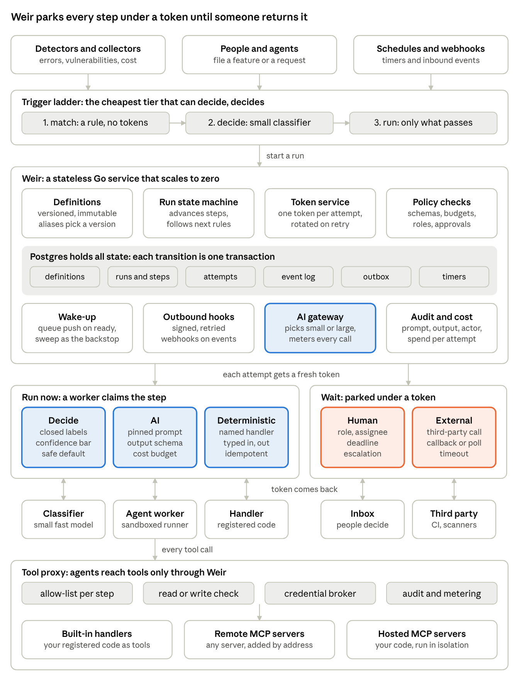

# Weir: an AI-native workflow engine

Proposal, 11 November 2026. Status: draft for discussion; nothing here is implemented yet.

Weir is a proposed open-source workflow engine in which every step is one of five kinds (decide, AI, deterministic, human or external) and all five obey one contract: typed inputs and outputs, an owner, a budget and a full audit record. It runs as a stateless Go service on Postgres, scales to zero, and stores workflow definitions as versioned data.

## Why Weir

A weir is a low barrier across a river that lets water through at a controlled, measured rate. The engine does the same for work: everything flows, nothing passes unmeasured. One web search found no workflow project using the name; that is not a trademark or package-registry check.

No engine surveyed (Conductor, Step Functions, Temporal, the CNCF Serverless Workflow spec) offers the first four rows below, including the commercial ones.

| What makes it different | What that means in practice |
| --- | --- |
| AI is a first-class step kind | An AI step names a pinned, immutable prompt version, an output schema and a cost budget. The engine enforces all three. |
| One contract for five kinds of work | Decide, AI, deterministic, human and external steps share the same inputs, outputs, retries, timeouts and audit record. |
| Governance is enforced, not recorded | Budgets stop runs, schemas reject outputs, and a requester cannot approve their own step. |
| Full evidence per attempt | Every attempt stores its prompt, transcript, output, actor, cost and decision on an append-only log. |
| The cheapest tier goes first | Rules run before classifiers, and classifiers before agents. A large model is called only when a cheaper tier cannot decide. |
| Definitions are data | Workflows are versioned YAML documents, immutable once published. A new workflow needs no engine change. |
| Callbacks in both directions | Third parties resume a parked step with a token; Weir notifies third parties through signed hooks. |
| Postgres only, scales to zero | No cluster, no broker and no always-on server. Idle cost is the database. |
| The detector decides done | A fix counts only when the system that raised the problem confirms it has gone. |
| A governed tool marketplace | Any MCP server can be added, but agents reach tools only through Weir, with an allow-list per step, pinned tool lists and approval before writes. |
| Pipes plumb any system in | One installable Pipe per outside system carries its connection, the events it sends in, the notifications it receives and its tools. You plumb Weir in wherever a workflow is needed. |

Runner-up names were Sluice (taken on PyPI by two pipeline tools), Docket (several task queues use it) and Writ (a browser automation project uses it).

## How it works



Work enters from detectors, people or schedules and passes the trigger ladder: a rule first, a small classifier second, and only what passes starts a run. Weir issues a fresh token for every attempt: decide, AI and deterministic steps are claimed by workers, while human and external steps wait until the token comes back. Each transition is one Postgres transaction that also queues the wake-up, any outbound hooks and the audit record. An agent's tool calls go back through Weir, which checks, authorises and records each one.

## Core concepts

The contract has sixteen nouns. Everything else in the engine is built from them.

| Noun | Meaning |
| --- | --- |
| Definition | A YAML document describing a workflow: its triggers, its steps, their kinds, and how they connect. |
| Version | An immutable, numbered publication of a definition. Numbers are never reused or overwritten. |
| Alias | A stable name such as `live` that points at a version. Callers start runs through an alias. |
| Trigger | What starts a run: a source of events, a `match` rule, and an optional `decide` that filters what the rule let through. |
| Run | One execution of one version. A run stays on the version it started with. |
| Step | A unit of work in a definition. Its `kind` is `decide`, `ai`, `deterministic`, `human` or `external`. |
| Attempt | One try at a step. Each retry is a new attempt record linked to the one before. |
| Token | An unguessable handle issued per attempt. Whoever returns it with a result completes the step. |
| Event | An append-only record of something that happened to a run, step or attempt. The event log is the audit trail. |
| Hook | An outbound notification Weir sends to another system when a named event occurs. |
| Connection | A named set of credentials and an address for a third party, held outside the definition. |
| Handler | Registered code that a deterministic step calls by name. |
| Tier | A named model size: a model, an effort level and a context size. The AI gateway picks a tier for each call. |
| Tool | A named action an AI step may call, classed as a read or a write. A step can call only the tools it lists. |
| Tool server | An MCP server that provides tools: built in, remote, or hosted. Its versions and manifest live in the catalogue. |
| Pipe | An installable, versioned unit that plumbs one outside system into Weir. It bundles that system's connection, its inlets, its outlets and its tools. |

## The definition contract

A definition is one YAML document: a header, an input schema, and an ordered list of steps that each declare a `kind`. The example below is a self-healing workflow that uses all five kinds. The syntax is a proposal, not yet implemented.

```yaml
weir: "0.1"
namespace: platform
name: remediate-incident
version: 4

input:
  schema: schemas/incident.json

triggers:
  - source: logs.errors                # an inlet of the installed logs Pipe
    match: event.severity in ["error", "critical"]   # tier 1: a rule, no tokens
    decide:                            # tier 2: runs only on what the rule passed
      template: is-actionable@2
      labels: [actionable, noise]
      default: noise
      start_on: actionable

tiers:                                 # named model sizes, resolved by the gateway
  small: { model: provider/small, effort: low, context: lean }
  large: { model: provider/large, effort: high }

steps:
  - id: route
    kind: decide
    template: incident-route@3         # pinned, immutable
    labels: [fix, needs_human]
    confidence: 0.8
    default: needs_human               # used when unsure, or when the model is down
    next:
      - when: label == "fix"
        go: open_issue
      - go: needs_human

  - id: open_issue
    kind: deterministic
    handler: scm.open_issue            # GitHub, GitLab, Azure DevOps behind one name
    input:
      title: input.title
      labels: [remediation]
    compensate: scm.close_issue        # undo, declared beside the step it undoes

  - id: fix
    kind: ai
    prompt: fix-incident@7             # pinned, immutable prompt version
    tier:                              # the gateway picks the model for this input
      decide: { template: fix-size@1, labels: [small, large], default: large }
    tools:
      read: [scm.read_file, scm.search, logs.search]
      write: [scm.create_branch]       # a write must be listed by name
    sandbox: { network: none, deny_paths: ["billing/**", ".github/**"] }
    output: { schema: schemas/change.json }
    budget: { usd: 15.00, minutes: 45 }
    on_failure: block                  # stop here; the run can be resumed later

  - id: approve
    kind: human
    assign: { role: approver, not: run.requester }
    timeout: 48h
    escalate:
      - { after: 24h, role: lead }
    outcomes: [approved, rejected]
    next:
      - when: outcome == "rejected"
        go: needs_human

  - id: merge
    kind: deterministic
    handler: scm.merge
    on_failure: cancel                 # end the run and undo completed steps

  - id: verify
    kind: external
    connection: detector               # credentials live in the connection
    call: { method: POST, path: /verify, body: { incident: input.id } }
    resume: callback                   # or: poll
    timeout: 2h
    hooks:
      - on: step.succeeded
        connection: chat
        send: { text: "Incident cleared" }
    end: true

  - id: needs_human
    kind: human
    assign: { role: on_call }
    timeout: 24h

hooks:
  - on: run.failed
    connection: pager
```

A definition is checked when it is published, and refused if it breaks any of these rules.

- Every step has a `kind`, and only the fields that kind allows.
- Every AI step names a prompt version, an output schema and a budget.
- Every decide step, and every trigger's `decide`, names a template version, a closed list of labels and a default label.
- Every reference to an earlier step's output resolves against that step's output schema.
- Prompts, templates, handlers, connections, tiers, tools and sub-workflows are resolved and pinned at publish time.
- No secret appears in a definition. Third parties are reached through named connections.
- A published version is never changed. A change is a new version.

## What an `ai` step has gained since this was written

This document is the design. The engine has since added settings to an `ai` step that the definition above does not show. The README describes each in full.

| Setting | What it does |
|---|---|
| `files:` | Documents fetched for the agent to read, or the files an earlier step produced |
| `writes:` | Lets the agent produce files, with limits on how many and how large, and rules for which paths it may change (`only`, `never`, and a list protected by default) |
| `workspace:` | Names registered code that fills the agent's working directory before it runs, such as a checkout. What the agent changed there is kept. `discard: true` keeps nothing |
| `shell:` | Gives an agent run beside the worker a sandboxed shell, with a list of hosts it may reach |

Three things here differ from the design above:

- **`sandbox:` is not acted on.** It parses, and publishing says so. Which paths an agent may change is under `writes`, and what a shell may reach is under `shell`.
- **Where an agent runs is not in the definition.** Whoever runs Weir chooses: beside the worker, or in a container of its own with every tool. The same definition runs either way.
- **An external step's data is its `input:`**, like every other kind of step. `call.body` is an older way of writing the same thing.

## The five step kinds

The five kinds use two mechanisms. Decide, AI and deterministic steps run now: a worker claims the step and returns a result. Human and external steps wait: the step is parked until someone returns its token.

| Kind | Completed by | Must declare | Engine guarantees |
| --- | --- | --- | --- |
| `decide` | A small classifier model | Template version, label list, default label | The answer is always one of the declared labels. Low confidence or any failure returns the default. The step has no tools. |
| `ai` | A sandboxed agent worker | Prompt version, allowed tools, output schema, budget | Output is rejected if it fails the schema. The run stops when the budget is spent. The full transcript is stored. |
| `deterministic` | A worker running registered code | Handler name | Input and output are checked against the handler's declared types. Each attempt carries an idempotency key. |
| `human` | A person, through the approval inbox or API | Assignee or role, timeout | The requester cannot be the approver when `not: run.requester` is set. Timeouts escalate along the declared chain. |
| `external` | A third party, by callback or by polling | Connection, call, resume mode, timeout | A callback is accepted only with the current attempt's token. A poll repeats until a declared condition holds. |

All five kinds share the same envelope: `input`, `output`, `retry`, `timeout`, `next`, `on_failure`, `compensate` and `hooks`. Every kind produces the same attempt record, so the audit trail does not depend on who did the work.

**Failure policy.** Every step declares what happens to the steps after it when it fails for good, meaning its retries are used up.

| `on_failure` | What happens | Use it when |
| --- | --- | --- |
| `block` (default) | The run stops at this step and keeps its completed results. It can be resumed from here | The failure needs a person or a fix, and the work so far is still good |
| `cancel` | The run ends. Completed steps that declared `compensate` are undone in reverse order | Later steps make no sense without this one, and earlier effects should not be left behind |
| `continue` | The run carries on along `next`, with this step recorded as failed | The step is optional, such as a notification or an enrichment |

A third party that cannot hold a token is matched by content instead. The step declares which fields of the inbound message must equal which values, and the engine resumes the step whose expectation matches.

## Spending as few tokens as possible

Weir treats a model call as the last resort: work goes to the cheapest tier that can do it, and a larger model is used only when a smaller one cannot decide. The contract builds this in at three points.

| Tier | What runs | Declared as | Use it when |
| --- | --- | --- | --- |
| 1. Rule | Code. No model, no tokens | A trigger's `match`, or a `deterministic` step | The answer can be computed |
| 2. Classifier | A small model that returns one label | A trigger's `decide`, or a `decide` step | The answer is one of a few known labels |
| 3. Small agent | An AI step on a small tier with a lean context | An `ai` step routed to `small` | The work is simple, such as replying to "thanks" |
| 4. Large agent | An AI step on a large tier with tools | An `ai` step routed to `large` | The work needs judgement or several steps |

**The trigger ladder.** A trigger names a source, a `match` rule and an optional `decide`. The rule runs on every inbound event and costs nothing. The classifier runs only on events that pass the rule. A run starts only for events the classifier labels as worth it. Events that fail either tier are counted and dropped without touching the run tables.

**The decide step.** A `decide` step asks a small model to pick one label from a closed list. It declares a pinned template, the labels and what each means, a confidence threshold and a default. The engine returns the default whenever the model is unsure, slow, unavailable or answers outside the list, so nothing downstream depends on the model being up. A decide step has no tools, and its input is treated as information, never as instructions.

**The AI gateway.** Every model call from a `decide` or `ai` step passes through one gateway. It does five things.

1. **Routes.** An `ai` step can declare a `tier` decision. The gateway runs it on the step's input and picks the model, effort and context size for that tier. When the decision is unsure, the step runs on the larger tier.
2. **Meters.** Tokens and cost are recorded against the attempt before the result is returned.
3. **Enforces.** A call that would exceed the step's or run's budget is refused.
4. **Falls back.** If a provider fails, the gateway tries the next one declared for that tier.
5. **Protects.** A circuit breaker per provider stops calls to one that is failing, and a rate limit per workspace stops one tenant starving the others.

Routing can run in shadow mode: the label is recorded but the usual model still runs, so quality and latency can be compared by label before the routing is switched on.

**Prior art.** This design is taken from an earlier production assistant by the same author, where a classifier called Jev labels each inbound email and chat message before any large model sees it. Measured there on 11 October 2026, the classifier answered in about 0.25 seconds against 1.8 for a small general model, and 462 decisions cost under $0.13 in total. About 17% of decisions fell back to their default, which is the number to watch per decision.

## Pipes

A Pipe is how an outside system is plumbed into Weir. Each Pipe covers one system, such as a source control provider, an error tracker or a chat tool, and carries everything a workflow needs to work with it. You install the Pipe once and use its parts wherever a workflow needs them.

Without Pipes, connecting a system means learning four separate things: a connection, trigger sources, hooks, and tools. A Pipe bundles them.

| Part of a Pipe | Direction | What it is | Used in a definition as |
| --- | --- | --- | --- |
| Connection | Both | The system's address and how to authenticate to it. Credentials are held outside the definition | `connection: scm` |
| Inlets | In | Events the system sends that can start a run or resume a parked step | `triggers: - source: scm.issue_opened` |
| Outlets | Out | Notifications and calls Weir can make to the system | `hooks: - connection: chat` and `external` steps |
| Tools | Out | Actions an AI step may call, each classed as a read or a write | `tools: read: [scm.read_file]` |
| Handlers | Out | Actions a deterministic step may call | `handler: scm.open_issue` |

A Pipe is described by a manifest. This sketch shows the shape; the syntax is a proposal.

```yaml
pipe: scm-github
version: 2.1.0
system: GitHub

connection:
  auth: oauth                          # or api_key, workload_identity
  sites: ["https://api.github.com"]    # the only places it may reach

inlets:
  - name: issue_opened
    schema: schemas/issue.json
  - name: pull_request_merged
    schema: schemas/pull_request.json

outlets:
  - name: comment
    schema: schemas/comment.json

tools:
  - { name: read_file, class: read }
  - { name: search, class: read }
  - { name: create_branch, class: write }

handlers:
  - { name: open_issue, compensate: close_issue }
  - { name: merge }
```

- **One name, many providers.** A definition refers to `scm`, not to GitHub. Which Pipe is bound to that name is an installation choice, so the same workflow runs against GitLab, Bitbucket or Azure DevOps by installing a different Pipe.
- **Pipes are versioned and pinned.** A published definition pins the Pipe versions it was checked against. A Pipe update follows the same review as any catalogue entry.
- **A Pipe cannot widen its own reach.** Its manifest lists the sites it may contact and the class of every tool. Weir enforces both.
- **Pipes are what the catalogue lists.** The marketplace in the next section is a catalogue of Pipes.

A Pipe is not a pipeline. A Pipe connects a system; a workflow is what runs.

## Tools and the marketplace

An AI step gets its abilities from tools, and Weir is the only path to them. An agent never connects to a tool server itself: every tool call goes through Weir, which checks it against the step's allow-list, supplies the credential, runs the call and records it. Tools use the Model Context Protocol (MCP), so any existing MCP server can be added.

**Where tools come from.**

| Source | What it is | Who runs it |
| --- | --- | --- |
| Built-in | A registered handler exposed to agents as a tool | Weir |
| Remote server | Any MCP server reachable over HTTPS, added by its address | Its owner |
| Hosted server | Your own code, built from a pinned source and run in isolation | The hosted service, or the operator |
| Catalogue entry | A published, versioned tool server that others can install | Either of the two above |

**How a step uses tools.** A step lists the tools it may call, split by what they can do.

```yaml
- id: fix
  kind: ai
  prompt: fix-incident@7
  tools:
    read: [scm.read_file, scm.search, logs.search]
    write: [scm.create_branch]         # a write must be listed by name
    approve: [tickets.close]           # parked for a person before it runs
```

- A step can call only the tools it lists. The list is pinned when the definition is published.
- Every tool is a read or a write. A tool that does not say which is treated as a write.
- A write listed under `approve` is parked under a token, like a human step, until a person approves that exact call.
- Tool output is information, never instructions. Once a run has read from a third-party tool, it cannot write to a different third party without approval.
- If a server's tool list changes after it was approved, its writes pause until the change is reviewed.
- Only the tools a step needs are described to the model. A long list is loaded on demand through a search tool, which keeps prompts small.

**The catalogue.** The catalogue lists Pipes. A catalogue entry is a Pipe with immutable versions. Each version carries a manifest: the runtime kind, the pinned source commit or image digest, the exact tool list and its hash, the sites the server may reach, the kinds of credential it needs, and its resource limits. A policy can narrow a manifest but never widen it. Installing an entry means consenting to one exact manifest and policy. An update is a new version, shown as a difference to review before it replaces the old one. An entry's visibility is private, workspace, unlisted or public.

**Credentials.** A tool server is reached through a connection, and the agent never sees the credential. For a server that uses OAuth, Weir tries three ways to identify itself, in order: a published client document, dynamic registration, then a client the operator registered by hand. Tokens are sealed at rest, refreshed on use, and revoked at the provider when the connection is removed. For a hosted server, a broker injects the credential only on requests to the site the manifest declares, and removes it from responses, so the server's own code never holds it.

**Two profiles, one contract.** A workflow written against one profile runs unchanged on the other.

| | Self-hosted (open source) | Hosted service |
| --- | --- | --- |
| Who adds a tool server | The operator, in configuration | Any workspace, from the catalogue |
| Trust | The operator trusts what they install | Nothing runs until it is reviewed |
| Credentials | The operator's own secret store | Brokered and sealed per workspace |
| Isolation | The operator's network rules | Per-server isolation with no route out except through the broker |
| Review | Optional | Required before first use and on every change |

**What already exists.** This design is taken from that earlier assistant. Status below is read from its code and changelog on 11 November 2026, not observed in a running deployment.

| Element | Status in the earlier system |
| --- | --- |
| All tool calls proxied through the API, with an allow-list per prompt template | Built and live |
| Remote MCP servers added by a user, with OAuth discovery | Built and live |
| Read and write classification, with confirmation before a write | Built and live |
| Tool-list pinning, taint tracking and an outbound network guard | Built and live |
| Versioned manifests with consent hashes | Built |
| Hosted servers with isolation and a credential broker | Built; switched off in production |
| A public catalogue with publisher review and installs across tenants | Not built: the schema allows it, the code refuses it |
| Cost recorded per tool call | Not built |

Weir adds three things the earlier system lacks: a public catalogue with publisher review, a cost recorded for every tool call through the gateway, and a read or write classification set by the reviewer instead of taken from the server's own claim.

## Callbacks and hooks

Weir talks to other systems in both directions, and the two directions are separate features. A callback comes in and moves a run forward. A hook goes out and tells someone what happened.

| | Inbound callback | Outbound hook |
| --- | --- | --- |
| Purpose | A third party reports that its work is done, so the next step can begin | Weir tells a third party that a step or run reached a state |
| Declared on | An `external` step, with `resume: callback` | Any step, or the whole definition, under `hooks` |
| Addressed by | The attempt's token, or a content match on the message | A named connection |
| Effect on the run | Completes the parked step and advances the run | None. A failed hook never fails the run |
| Delivery | Accepted once. A repeat or a stale token is rejected and reported | At least once, signed, retried with backoff |

**Inbound.** When an external step starts, Weir calls the third party and passes a callback address containing the attempt's token. The step then consumes nothing while it waits. When the third party calls back, Weir checks the token, validates the payload against the step's output schema, records the result, and starts the next step in the same transaction. A callback for a step that has timed out or been retried is refused, because the token has rotated.

**Outbound.** A hook names an event and a connection. The events are `step.started`, `step.waiting`, `step.succeeded`, `step.failed`, `step.timed_out`, `run.started`, `run.succeeded` and `run.failed`. Each hook is written to an outbox in the same transaction as the event it reports, then delivered separately. Each delivery carries a signature and a unique delivery id so the receiver can verify it and ignore duplicates.

A step that must call a third party and wait for the answer is an `external` step. A notification that nobody waits on is a hook. A deterministic step that needs to tell a third party it has finished uses a `step.succeeded` hook.

## Governance

The engine enforces these rules itself. A workflow author cannot switch them off, and a worker cannot bypass them.

| Guarantee | How it is enforced |
| --- | --- |
| Prompts are pinned | An AI step names a prompt version. Versions are immutable, and each attempt stores a hash of the rendered prompt. |
| Outputs are checked | Every AI output is validated against its JSON Schema before the run advances. A failure is a failed attempt. |
| Budgets stop work | Spend is counted per attempt, step and run. Reaching a limit raises a budget error that a catch-all handler does not swallow. |
| Model calls go through one gateway | Every model call is routed, metered against its attempt and checked against the budget in one place. |
| Decisions fail safe | A decide step returns its declared default when the classifier is unsure, slow or unavailable. |
| Duties are separated | A human step can exclude the run's requester. The engine checks the actor, not the user interface. |
| Trusted work is still sampled | A `next` rule can send a fraction of runs to a person with `sample(seed, rate)`. The pick is made from the seed alone, so it is the same on a retry and can be checked afterwards. |
| The harness holds the keys | The agent proposes; registered deterministic handlers commit, push and merge. Write credentials are issued to the handler, never to the agent. |
| Evidence is complete | Each attempt records the prompt, full transcript, tool calls, output, actor, tokens, cost and duration. |
| The log cannot be rewritten | Events are append-only, enforced in the database. Current state is derived from the log. |
| Retries are bounded | AI steps default to one attempt. More must be declared, because every retry costs money. |
| Done is decided outside | A workflow can end on an `external` step that asks the original detector whether the problem has gone. |
| Agents never hold credentials | Every tool call is made by Weir on the agent's behalf. The credential is added after the allow-list check and never enters the model's context. |
| Tool lists are pinned | A tool server's tool list is hashed when approved. A changed list pauses its writes until someone reviews the difference. |
| Failures are contained | Every step declares a failure policy, and a circuit breaker in front of each provider and third party stops a fault from spending retries or budget. |

The budget and separation rules address gaps found in earlier engines by the same author: cost was recorded but never capped, and a requester could approve their own gate.

## Runtime

Weir is one stateless Go service and one Postgres database. Because definitions are data and step kinds are fixed, the engine stores the current step and each step's output, and never replays code.

**State.** Postgres holds definitions, runs, steps, attempts, the event log, the outbox and timers. A state change and the record that makes the next step runnable commit in one transaction, so they cannot disagree.

**Scale to zero.** A worker on scale-to-zero compute cannot wake itself, so the engine does not poll. Each transition that makes a step runnable also queues a wake-up message, and a scheduled sweep picks up anything whose wake-up was lost, along with due timers and expired leases. A step waiting on a person or a third party consumes nothing.

**The bus is transport, never truth.** Wake-ups and hook deliveries go through a small adapter interface with two operations: deliver a wake-up, and publish an event. Adapters can target Google Cloud Tasks and Pub/Sub, AWS SQS and SNS, or Postgres notifications for local use.

**Correctness rules.** These are the points where home-grown Postgres engines most often fail.

1. Claim a step in a short transaction that sets a lease and increments the attempt number.
2. Run the work outside any transaction.
3. Complete with a write conditioned on the attempt's token, so a stale worker is rejected.
4. Treat AI and third-party calls as at-least-once, each with an idempotency key.
5. Store a step's output once and never recompute it on resume.
6. Keep timers as rows, not as in-memory waits.
7. Keep large payloads in object storage and store a reference.

**Circuit breakers and rate limits.** Every model provider and every connection to a third party sits behind a circuit breaker. When calls to it keep failing or run slow, the breaker opens and further calls fail at once with a reserved error. A step that hits an open breaker is rescheduled on a timer and does not use up a retry, so one broken third party cannot burn through attempts or budgets. The breaker lets a single test call through after a pause and closes again when it succeeds. Each workspace also has a rate limit on model calls and tool calls. Breaker state lives in Postgres, so it holds across instances and survives scale to zero.

**Versioning.** A run stays on the version it started with. A failed run can be resumed from the failed step, keeping completed results. A long-lived run moves to a newer version only at a step the definition marks as a safe upgrade point.

The wake-up and sweep design is derived from Cloud Run's documented behaviour. No published engine was found that runs this way, so it is the first thing to prove in a prototype.

## Open source plan

Weir is designed so that the contract is the product and the engine is its reference implementation. That gives contributors a small, stable core and many independent places to add value.

**Licence.** Apache 2.0 is proposed, for its patent grant and because Conductor and the CNCF spec use it. Temporal and DBOS use MIT, which is the simpler alternative.

**Repository layout.**

| Path | Holds |
| --- | --- |
| `spec/` | The contract: a JSON Schema for definitions, the event catalogue, the error types, and the written rules |
| `conformance/` | Test definitions with expected event logs, so any implementation can prove it follows the contract |
| `engine/` | The Go reference engine and its Postgres schema |
| `adapters/` | Wake-up and event transports, source control providers, model providers |
| `handlers/` | A standard library of deterministic handlers |
| `inbox/` | A minimal approval screen and its API |
| `examples/` | Complete workflows, starting with self-healing and vulnerability remediation |
| `docs/` | The implementation guide |
| `tools/` | The tool proxy and the manifest schema |
| `pipes/` | Pipes for common systems, each with its manifest, inlets, outlets, tools and handlers |

**Where contributors can start.** Each of these is self-contained and needs no change to the engine.

- A Pipe for a system you use. A source control Pipe (GitLab, Bitbucket, Azure DevOps) is the most useful first one.
- A transport adapter (SQS and SNS, NATS, Kafka).
- A model provider behind the AI step.
- A handler for a common task, with its declared input and output types.
- An example workflow with its conformance test.
- An inlet, outlet or tool added to an existing Pipe.

**Roadmap.**

| Milestone | Contents |
| --- | --- |
| 0.1 Contract | The definition schema, the event catalogue, and this spec turned into an implementation guide |
| 0.2 Engine | Runs, the five step kinds, tokens, retries, timeouts, failure policies, the event log, on Postgres with a local transport |
| 0.3 Scale to zero | The wake-up and sweep path on Cloud Run, with a measured idle cost |
| 0.4 Governance | Budgets, the AI gateway and model routing, circuit breakers and rate limits, prompt registry, separation of duties, the approval inbox |
| 0.5 Pipes | The Pipe manifest, hooks, connections, compensation, the tool proxy with remote MCP servers, and the first source control Pipes |
| 1.0 | A frozen contract and a passing conformance suite, proven by a real platform running on it |

The engine should have at least two real workflows running on it before the contract is frozen.

The public catalogue and hosted tool servers follow 1.0. They depend on review and isolation, which the hosted service provides first.

## Open questions

- [ ] Is the name free? Check trademarks, the Go module path, package registries and the GitHub organisation.
- [ ] Apache 2.0 or MIT?
- [ ] Should events on the bus be encoded as Protocol Buffers or JSON? Measured on 10,000 events: in Go, Protocol Buffers round-trips 2.3 times faster than JSON and is 23% smaller (381 against 498 bytes). Proposed: define events in Protocol Buffers, send binary on the bus, and send JSON to hooks. See [the benchmark](../research/05-bus-encoding-benchmark.md).
- [ ] Would a Rust engine be meaningfully faster than Go for this workload? Measured on the same events: Rust round-trips Protocol Buffers 2.6 times faster than Go. Go still takes only about 2 microseconds an event, so encoding is not the bottleneck. Proposed: stay with Go.
- [ ] What does the wake-up and sweep pattern cost against one always-on small instance? This number decides whether DBOS is worth revisiting.
- [ ] What expression language do `when`, `match` and `input` use? The proposal is a small reference syntax checked at publish time, not a general language.
- [ ] Do parallel branches and fan-out over a list belong in 0.2, or later?
- [ ] Does the prompt registry live in Weir, or is it a separate service Weir pins against?
- [ ] How does an agent worker authenticate to a model provider without a personal subscription token?
- [ ] Should a definition be exportable to the CNCF format once that spec gains an AI task?
- [ ] Which classifier backs `decide` by default, and can it run self-hosted so the open-source engine has no paid dependency?
- [ ] What default-rate on a `decide` step should raise a warning that its labels are unclear?
- [ ] Is "Pipes" clear of name clashes, and do "inlet" and "outlet" read naturally to people who have not seen the metaphor?
- [ ] Who reviews entries for the public catalogue, and against what checklist?
- [ ] Can hosted tool servers run on something other than Google Cloud? The earlier version is tied to it.
- [ ] Should a third-party tool's schema be shown to the model directly, or reached through a few generic tools? Generic tools keep prompts small but cost an extra round trip.
- [ ] What thresholds open a circuit breaker by default, and who is allowed to reset one by hand?

## Sources

This proposal rests on the research in this repository, all produced on 11 November 2026. Each document lists what is unverified.

- [Workflow engine contract options](../research/02-workflow-engine-contract-options.md): Conductor, Step Functions, the Serverless Workflow spec, Temporal and DBOS
- [Meta's workflow systems](../research/04-meta-workflow-systems.md)
- [Bus encoding benchmark](../research/05-bus-encoding-benchmark.md)

External references:

- [Conductor OSS](https://github.com/conductor-oss/conductor): task types, the workflow and task definition split, schema validation
- [AWS Step Functions developer guide](https://docs.aws.amazon.com/step-functions/latest/dg/choosing-workflow-type.html): task tokens, versions and aliases, the event history
- [Open Workflow Specification](https://github.com/open-workflow-specification/specification), formerly CNCF Serverless Workflow: document shape, retry shape, error types
- [Temporal production checklist](https://docs.temporal.io/self-hosted-guide/production-checklist): the cost of self-hosting
- [DBOS on Cloud Run](https://docs.dbos.dev/production/hosting-with-cloud-run): the always-on instance requirement
- [Cloud Run container contract](https://docs.cloud.google.com/run/docs/container-contract): why a scaled-to-zero worker cannot wake itself
- Name checks: [sluice-pipeline](https://pypi.org/project/sluice-pipeline/), [usewrit](https://github.com/usewrit), [docket](https://github.com/abrookins/docket)
